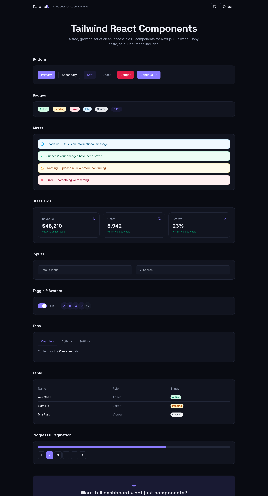

# Tailwind React Components — Free Copy-Paste UI

A free, growing set of clean, accessible **Tailwind CSS + React** UI components for **Next.js 14**. Copy, paste, ship. Dark mode included, zero dependencies beyond Tailwind + `lucide-react`.




> ⭐ **Star the repo** if it saves you time — it helps others find it.

## 🧩 Components included

Buttons · Badges · Alerts · Stat cards · Inputs · Search field · Toggle · Avatar group · Tabs · Table · Progress bar · Pagination — all themeable with CSS variables and dark-mode ready.

## 🚀 Quick Start

```bash
git clone https://github.com/omer-poyraz/tailwind-react-components.git
cd tailwind-react-components
npm install
npm run dev
# open http://localhost:3000
```

Every component lives in `app/page.tsx` — **copy any block straight into your project.** They use plain Tailwind classes plus a few CSS variables (`--brand`, `--surface`, `--border`…) you can define once.

## 🎨 Theming

Colors are driven by CSS variables in `app/globals.css`. Change `--brand` and the whole set follows. Light/dark handled with `data-theme` + `prefers-color-scheme`.

---

## ⭐ Building an admin panel? Skip the boilerplate

These components power a full set of **production-ready Next.js dashboards**:

### 👉 [**Admin Templates Bundle — 6 dashboards for $99**](https://omerpoyraz.gumroad.com/l/nextjs-admin-bundle)  ·  [free admin starter](https://github.com/omer-poyraz/nextjs-admin-dashboard-starter)

| Dashboard | Highlight |
|---|---|
| [E-Commerce Admin](https://omerpoyraz.gumroad.com/l/ecommerce-admin-nextjs) | SEO-first product editor |
| [Sales CRM](https://omerpoyraz.gumroad.com/l/sales-crm-nextjs) | Drag-and-drop pipeline |
| [SaaS Metrics](https://omerpoyraz.gumroad.com/l/saas-metrics-nextjs) | Cohort retention heatmap |
| [Blog / CMS](https://omerpoyraz.gumroad.com/l/blog-cms-nextjs) | Markdown editor + preview |
| [Project Manager](https://omerpoyraz.gumroad.com/l/project-manager-nextjs) | Gantt timeline |
| [Help Desk](https://omerpoyraz.gumroad.com/l/helpdesk-admin-nextjs) | Ticket inbox |

### 👉 [**Get all 6 for $99 (over 40% off) →**](https://omerpoyraz.gumroad.com/l/nextjs-admin-bundle)

---

## 📄 License

MIT © [Ömer Poyraz](https://omerpoyraz.gumroad.com). Free for personal and commercial use.

## 🔖 Keywords

`tailwind components` · `react components` · `tailwind ui` · `nextjs components` · `tailwind css components` · `free tailwind components` · `react ui library` · `typescript components`
